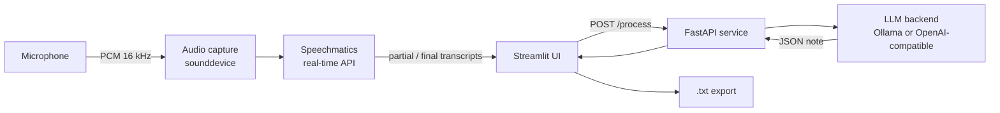

# DocScribe

[](https://github.com/aitessam/doc_scribe/actions/workflows/ci.yml)


**Real-time Urdu + English medical transcription and structured clinical note generation.**

DocScribe listens to a doctor-patient consultation, transcribes it live (including natural Urdu/English code-switching) and turns the transcript into a structured clinical note with an LLM, ready to review and export.

---

## Why

In bilingual clinics across South Asia, patients often describe symptoms in Urdu while doctors document in English. That constant mental translation slows consultations and leads to incomplete records. DocScribe removes the typing: the doctor talks to the patient, and a structured note is waiting at the end.

## Features

- **Live bilingual transcription** of Urdu and English via the Speechmatics real-time WebSocket API, with partial and final results
- **Structured note extraction** into eight clinical fields: presenting complaints, symptoms, diagnosis, vitals, premorbid conditions, medication, lab tests and consultation notes
- **Pluggable LLM backend**: run fully locally with Ollama (Mistral, Llama 3) or point at any OpenAI-compatible endpoint
- **Correct right-to-left rendering** of Urdu script in the UI (Arabic reshaping + bidi)
- **Resilient by design**: retry with exponential backoff on transcription drops, LLM timeout retries, tolerant JSON parsing and typed domain errors mapped to HTTP status codes
- **One-click export** of transcript and note as `.txt`
- **Docker Compose** stack including a local Ollama service

## Architecture



| Layer | Module | Responsibility |
| --- | --- | --- |
| Audio | `app/transcription/audio.py` | Microphone capture into a thread-safe queue |
| Transcription | `app/transcription/transcriber.py` | Speechmatics WebSocket client, event normalisation, retries |
| LLM | `app/llm/processor.py`, `prompts.py` | Prompting, backend selection, response parsing and validation |
| API | `app/api/routes.py`, `server.py` | `POST /process`, `GET /health`, error-to-status mapping |
| UI | `streamlit_app.py` | Recording controls, live transcript, note review and export |
| Config | `config/settings.py` | Typed settings from environment via `pydantic-settings` |

## Tech stack

Python · FastAPI · Streamlit · Speechmatics · Ollama · Pydantic · httpx · pytest · Docker · GitHub Actions

## Getting started

### Prerequisites

- Python 3.10+
- [PortAudio](http://www.portaudio.com/) (needed by `sounddevice`; bundled on Windows and macOS wheels, `apt install libportaudio2` on Debian/Ubuntu)
- A [Speechmatics](https://www.speechmatics.com/) API key
- [Ollama](https://ollama.com/) with a model pulled (for example, `ollama pull mistral`), or any OpenAI-compatible endpoint

### Run locally

```bash
git clone https://github.com/aitessam/doc_scribe.git
cd doc_scribe

python -m venv .venv
source .venv/bin/activate        # Windows: .venv\Scripts\activate
pip install -r requirements.txt

cp .env.example .env             # then add your SPEECHMATICS_API_KEY

python server.py                 # API on http://127.0.0.1:8000
streamlit run streamlit_app.py   # UI on http://localhost:8501 (second terminal)
```

### Run with Docker

```bash
cp .env.example .env
docker compose -f docker/docker-compose.yml up --build
docker compose -f docker/docker-compose.yml exec ollama ollama pull mistral
```

> Containers cannot access your host microphone, so for live recording run the Streamlit UI on the host and use Docker for the API and Ollama.

## Configuration

All settings are read from environment variables or `.env` (see [`.env.example`](.env.example)).

| Variable | Default | Description |
| --- | --- | --- |
| `SPEECHMATICS_API_KEY` | *required* | Speechmatics API key |
| `SPEECHMATICS_URL` | `wss://eu2.rt.speechmatics.com/v2` | Real-time endpoint |
| `SPEECHMATICS_LANGUAGE` | `ur` | Transcription language |
| `LLM_ENDPOINT` | `http://localhost:11434/api/chat` | Ollama chat or OpenAI-compatible completions URL |
| `LLM_MODEL` | `mistral` | Model name at the endpoint |
| `LLM_TIMEOUT` | `120` | Seconds before an LLM request times out |
| `API_HOST` / `API_PORT` | `127.0.0.1` / `8000` | FastAPI bind address |
| `LOG_LEVEL` / `LOG_FILE` | `INFO` / `./logs/docscribe.log` | Logging |

## API

```http
POST /process
Content-Type: application/json

{ "transcript": "Doctor: Kya takleef hai? Patient: Teen din se bukhar hai..." }
```

```json
{
  "structured_note": {
    "presenting_complaints": "Fever for three days",
    "symptoms": "Fever",
    "diagnosis": "Not mentioned",
    "vitals": "Not mentioned",
    "premorbid_conditions": "Not mentioned",
    "medication": "Not mentioned",
    "lab_tests": "Not mentioned",
    "consultation_notes": "Not mentioned"
  },
  "success": true,
  "error": null
}
```

| Status | Meaning |
| --- | --- |
| `422` | Empty or oversized transcript |
| `502` | LLM returned an unparseable response |
| `504` | LLM timed out after retries |

Interactive docs are served at `http://127.0.0.1:8000/docs`.

## Testing

```bash
pip install -r requirements-dev.txt
ruff check .
pytest
```

The test suite mocks Speechmatics and the LLM backend, so it runs offline with no API keys. CI runs lint and tests on Python 3.10, 3.11 and 3.12.

## Project structure

```
├── app/
│   ├── api/             # FastAPI routes and error mapping
│   ├── llm/             # Prompt templates and note processor
│   ├── transcription/   # Audio capture and Speechmatics client
│   └── utils/           # Exceptions, logging, Urdu text rendering
├── config/              # Typed application settings
├── docker/              # Dockerfile and Compose stack
├── docs/PRD.md          # Product requirements and design
├── tests/               # pytest suite
├── server.py            # API entry point
└── streamlit_app.py     # UI entry point
```

## Roadmap

- Speaker diarisation (label doctor vs patient lines)
- Streaming note generation and live UI refresh via `st.fragment`
- PDF export and session history
- ICD-10 code suggestions and HL7 FHIR export

## Privacy notice

DocScribe processes protected health information. It is a portfolio and research project and is not certified for clinical use. Anyone deploying it must make sure their transcription provider, LLM host and storage meet the applicable data protection regulations. Running the LLM locally with Ollama keeps transcripts off third-party LLM services.

## Licence

[MIT](LICENSE) © Muhammad Aitessam
